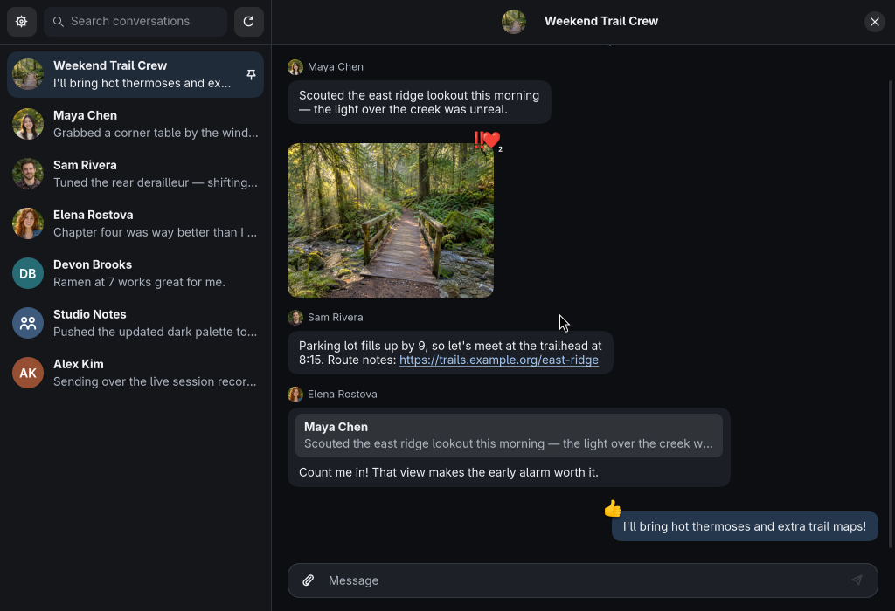

# BlueBubbles Native

A fast, lightweight, native Linux desktop client for [BlueBubbles Server](https://bluebubbles.app/), built with **Rust**, **GTK 4**, and **libadwaita**.



## Features

- **Native performance & small footprint** — compiled Rust + GTK 4 (~14 MB binary, no Electron runtime), with virtualized lists for instant scrolling and thread switching.
- **Offline-first caching** — opens cached conversations immediately while syncing in the background; scroll to the top of any thread to load older history.
- **Live messages & desktop notifications** — Engine.IO / Socket.IO streaming with automatic reconnect, quiet REST catch-up, and clickable native notifications.
- **Rich messaging** — multiline composer, file picker, drag-and-drop, and clipboard paste for images, videos, and files, inline image/video previews with an in-app lightbox viewer, clickable inline links, rich link cards, Tapback reactions, and threaded replies *(Tapbacks and replies require the BlueBubbles Private API)*.
- **Adaptive GNOME layout** — resizable sidebar at desktop widths that collapses cleanly into a single-column navigation view on narrow screens.
- **Themes, text scaling & system tray** — 7 built-in dark and light colorways (plus Follow System and high-contrast support), live text scaling (`80%–160%`), and optional StatusNotifierItem minimize/close-to-tray behavior.

## Requirements

- A running [BlueBubbles Server](https://bluebubbles.app/) on macOS
- **Rust 1.92+**, a C toolchain, and `pkg-config`
- **GTK 4.14+** and **libadwaita 1.5+**
- **libsecret** (`secret-tool`) for desktop keyring credential storage
- **FFmpeg** for video poster thumbnails *(playback uses your installed GTK media backend and codecs)*

On Arch Linux:

```sh
sudo pacman -S base-devel gtk4 libadwaita libsecret ffmpeg
```

## Build & Install

```sh
git clone https://github.com/lxe/bluebubbles-native.git
cd bluebubbles-native

# Run in development mode
cargo run --locked

# Or build an optimized release binary and install to ~/.local
cargo build --locked --release
install -Dm755 target/release/bluebubbles-native ~/.local/bin/bluebubbles-native
install -Dm644 data/co.lxe.BlueBubblesNative.desktop ~/.local/share/applications/co.lxe.BlueBubblesNative.desktop
install -Dm644 data/co.lxe.BlueBubblesNative.svg ~/.local/share/icons/hicolor/scalable/apps/co.lxe.BlueBubblesNative.svg
```

## Getting Started

1. Launch **BlueBubbles Native** and open **Preferences** (`Ctrl+,`).
2. In the **Server** tab, enter your BlueBubbles Server URL and password, then click **Connect**. Your password is stored in the system keyring — never in plaintext config files.
3. Use **Archived Chats** to restore archived threads, **Desktop** to configure tray behavior and notifications, and **Appearance** to switch colorways or adjust text size.

### Keyboard Shortcuts

| Shortcut | Action |
| --- | --- |
| `Ctrl+F` | Focus conversation search |
| `Ctrl+,` | Open Preferences |
| `Ctrl++` / `Ctrl+-` / `Ctrl+0` | Increase / decrease / reset text size |
| `Ctrl+M` | Minimize (or hide to tray when enabled) |
| `Ctrl+Q` | Quit |
| `Enter` / `Shift+Enter` | Send message / insert newline |
| `Ctrl+V` / `Shift+Insert` | Paste text, images, videos, or copied files into the composer |
| `Menu` or `Shift+F10` | Open context menu on focused row |

### Useful Tips

- **Pin or archive** any conversation from its right-click menu.
- **Reply, react, or copy** by right-clicking any message bubble or media item.
- **Open full-size media** by clicking any inline image or video thumbnail; right-click for **Copy** and **Download**.

## Data & Privacy

All local files use standard XDG directories resolved by GLib:

- **`~/.config/bluebubbles-native/preferences.json`** — server URL, sidebar width, pin/archive state, tray/notification toggles, colorway, and text size.
- **System keyring (`libsecret`)** — stores the server password securely outside the preferences file.
- **`~/.cache/bluebubbles-native/v1/`** — private (`0o700`) per-server cache of conversation summaries, message pages, contact/group avatars, media, and link previews.

## Development & Testing

See [DESIGN.md](DESIGN.md) for the UI design language, colorway system, squircle/icon specs, and GNOME patterns.

```sh
# Fast check (~1s): rustfmt, clippy (-D warnings), and Rust unit tests
./tests/run.sh

# Headless Xvfb GUI integration suites (runs against synthetic local fixtures)
./tests/run.sh --gui

# Full suite including Wayland fractional-scaling header seam check
./tests/run.sh --all

# Offline UI pattern kitchen sink (no server required)
cargo run --locked -- --patterns

# CLI connection check against saved credentials
cargo run --locked -- --check-connection
```

## License

[MIT](LICENSE)
